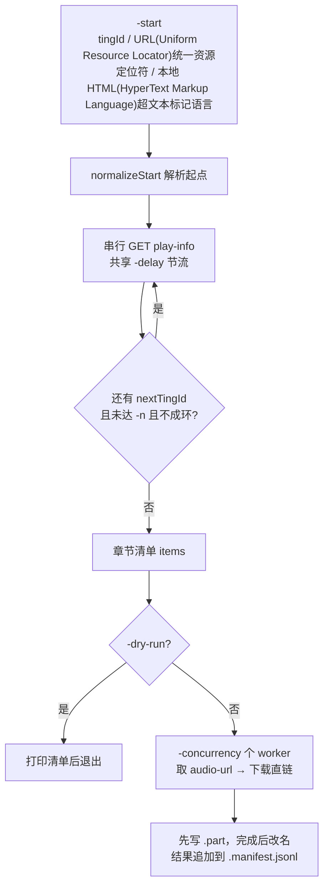

# ytb-dl · 悦听吧音频链式下载工具

从指定章节开始，沿 `play-info` 返回的 `nextTingId` 逐集向后遍历，批量获取并保存音频。仓库包含两部分：

| 文件 | 作用 |
| --- | --- |
| `ytb_dl.go` | Go 版 CLI(Command Line Interface)命令行界面下载器源码，仅依赖标准库 |
| `yuetingba-audio-url.user.js` | 浏览器用户脚本，在播放页显示/复制音频直链，用于调试和核对接口 |
| `ytb-dl` | 已编译好的 macOS arm64 可执行文件；其他平台请自行编译 |
| `go.mod` | 模块声明 `ytb-dl`，要求 Go 1.27 |
| `cookies.txt` | Netscape 格式 Cookie 样例文件（含真实值，勿外传/提交） |
| `books/` | 建议的下载输出目录 |

> **合规声明**：本项目仅用于你拥有版权或已获授权的内容，请遵守目标站点的服务条款与 `robots.txt`。工具默认串行采集、接口请求带最小间隔、遇 HTTP(HyperText Transfer Protocol)超文本传输协议 429 按服务端 `retryAfter` 退避，请保持克制，不要把 `-concurrency` 或请求频率调得过高。

## 工作原理

调用的是站点自身的两个 API(Application Programming Interface)应用程序编程接口：

```
GET {base}/api/app/docs-listen/{tingId}/play-info   → JSON(JavaScript Object Notation)JavaScript 对象简谱，含 nextTingId / audioUrl / tingTitle
GET {base}/api/app/docs-listen/{tingId}/audio-url   → 纯文本音频直链（也兼容 JSON(JavaScript Object Notation)JavaScript 对象简谱 字符串 / 对象）
```



采集阶段**串行**进行以防限流；下载阶段才按 `-concurrency` 并发，且所有接口请求仍共用全局节流。遍历会检测重复 `tingId`，防止接口异常导致死循环。

## 快速开始

### 1. 编译（Go 1.27+）

```bash
go build -o ytb-dl .
```

无第三方依赖。仓库里的 `ytb-dl` 是 darwin/arm64 二进制，其他系统需重新编译。

### 2. 准备身份信息

- **设备 ID**：在播放页控制台执行 `copy(localStorage.getItem('cn-docsite-user2-guid'))`，把得到的值传给 `-device-id`。服务端据此限流，缺省时程序不发 `X-Ytb-Device` 头，接口可能拒绝或更易触发 429。
- **Cookie**：用浏览器扩展或 curl 导出 Netscape HTTP(HyperText Transfer Protocol)超文本传输协议 Cookie 文件（7 列 Tab 分隔），默认读取 `./cookies.txt`；也可用 `-cookie` 直接传 Cookie 头字符串。该文件不存在时静默忽略（但显式指定路径却读取失败会报错）。
- 站点 Cookie 只会按域名/路径/Secure 匹配后发送，**不会**外带到第三方 CDN(Content Delivery Network)内容分发网络；`-cookie` 字符串也只发给站点域名。

### 3. 先试跑，再下载

```bash
# 只看清单，不发起下载
./ytb-dl -start 3a17f2ed-83a0-629e-beb3-69fc75e6745b -dry-run

# 从当前集开始，向后共下载 20 集
./ytb-dl -start 3a17f2ed-83a0-629e-beb3-69fc75e6745b \
    -n 20 -out ./books/绍宋 -cookies ./cookies.txt \
    -device-id 'fp1_xxxxxxxxxxxxxxxx'

# -start 也支持播放页 URL、/book/ting/<UUID(Universally Unique Identifier)通用唯一识别码> 路径，
# 或本地 HTML 文件（自动提取 data-ting-id / 页面中的 tingId）
./ytb-dl -start ./index.html -n 5 -dry-run
```

完整帮助随时可用：`./ytb-dl -h`。

## 参数一览

| 参数 | 默认值 | 说明 |
| --- | --- | --- |
| `-start` | 必填 | 起始集 tingId、播放页 URL、或本地播放页 HTML 文件 |
| `-n` / `-max-items` | `0` | 一共处理多少集；`0` = 沿 `nextTingId` 走到没有后集（`-max-items` 为兼容旧版的别名） |
| `-out` | `./downloads` | 输出目录，自动创建 |
| `-cookies` | `cookies.txt` | Netscape 格式 Cookie 文件 |
| `-cookie` | 空 | 直接传 Cookie 头字符串，如 `'a=1; b=2'` |
| `-device-id` | 空 | `X-Ytb-Device` 值，取自 `cn-docsite-user2-guid` |
| `-base` | `https://www.yuetingba.cn` | 站点 origin |
| `-user-agent` | Chrome 124 UA(User Agent)用户代理 | 请求头 |
| `-proxy` | 空 | 代理地址，如 `http://127.0.0.1:7890`；未指定时沿用环境变量 |
| `-ext` | 自动推断 | 强制输出扩展名（如 `.mp3`）；缺省按 URL 路径与 Content-Type 推断 |
| `-delay` | `1.0` | 接口请求最小间隔（秒），全局共享 |
| `-concurrency` | `2` | 下载并发数 |
| `-retries` | `3` | 单集失败重试次数，指数退避（1/2/4…上限 10 秒），每次重试重新取直链 |
| `-max-429` | `4` | 429 限流最大重试次数 |
| `-rate-limit` | `0` | 单任务下载限速 KB/s，`0` 不限 |
| `-timeout` | `30` | 建连 / 响应头超时（秒），不限制下载大文件的总时长 |
| `-overwrite` | `false` | 已存在的文件也重新下载 |
| `-dry-run` | `false` | 只打印清单，不下载 |
| `-insecure` | `false` | 关闭 TLS(Transport Layer Security)传输层安全证书校验，仅排查用，不安全 |

数值约束：`-n >= 0`、`-concurrency >= 1`、`-retries >= 0`、`-delay >= 0`、`-timeout >= 1`，否则直接退出并提示。

## 输出、断点与容错

- 文件名：`0001_标题.扩展名`；标题自带 `0001` / `0001_` 前缀时不再重复编号，非法字符会被清洗，长度截断到 80 字符。
- 下载先写 `.part`，校验 `Content-Length` 完成后才改名；不完整会保留 `.part`，下次以 `Range` 请求续传（服务端返回 206 追加、200 从头覆盖）。
- 每集结果追加写入输出目录下的 `.manifest.jsonl`，是 JSONL(JSON Lines)JSON 行 格式，含 `index / tingId / bookName / title / file / status / error`，`status` 为 `ok` / `skip` / `failed`。
- 已存在的成片（任意扩展名、排除 `.part`）默认跳过；失败时原样重跑即可跳过已完成集并续传半成品，无需从头再来。
- 支持 `Ctrl-C` / `SIGTERM` 优雅退出；结束时会打印 `完成 / 跳过 / 失败` 汇总，存在失败项时返回非零退出码。
- 进度日志走 stderr，结果与清单走 stdout，便于重定向。

## 用户脚本：`yuetingba-audio-url.user.js`

用 Tampermonkey / Violentmonkey 安装，仅在含 `#tpCard[data-ting-id]` 的播放页生效。右下角面板提供：

- **取 audio-url / 取 play-info**：复现接口请求并展示真实直链，附带前集/后集信息；
- **上一集 / 下一集**：从 `#prev-url` / `#next-url` 解析 tingId 后取地址；
- **复制地址 / 新窗口打开**：可配合 `GM_setClipboard`，也降级到 `document.execCommand`；
- **被动捕获**：监听 `<audio>` 的 `loadstart` / `play` 等事件，页面点播放时自动记录 `currentSrc`，不额外请求接口、不触发限流；
- 站内切集不刷新页面，通过 MutationObserver 跟随更新当前 ID；另注册两个油猴菜单命令。

脚本在页面内使用相对路径 + `credentials: 'same-origin'`，自动带 Cookie 与 origin，`X-Ytb-Device` 取自 localStorage；若站点换域名或用了镜像，补一行 `@match` 即可。若提示"未发现设备指纹"，先在页面点一次播放再试。

## 常见问题

| 现象 | 处理 |
| --- | --- |
| 提示 `[提示] 未提供 -device-id` / 频繁 429 | 补 `-device-id`；调大 `-delay`、调小 `-concurrency`。429 会按响应里的 `retryAfter`（默认 30 秒）自动退避 |
| `没有采集到任何章节` | 检查 `-start` 能否解析出 tingId、`-base`、`-cookies`、`-device-id` 是否正确；先用 `-dry-run` 验证 |
| `返回值不是音频地址` | `audio-url` 返回的不是 http(s) 链接，通常是登录态/权限失效；重新导出 Cookie、确认设备在浏览器里已点过播放 |
| `文件不完整 x/y 字节` | 保留 `.part`，原样重跑即会续传；必要时设 `-ext` 或用 `-retries` 增加重试 |
| 代理/证书导致请求失败 | 用 `-proxy` 指定代理；`-insecure` 只作临时排查，定位后应关闭 |

## 安全提醒

`cookies.txt` 和 `-device-id` 属于账号凭据，仓库里的样例文件含真实值。若把本目录纳入版本管理，建议先在 `.gitignore` 中加入：

```gitignore
cookies.txt
books/
downloads/
*.part
ytb-dl
.DS_Store
```
